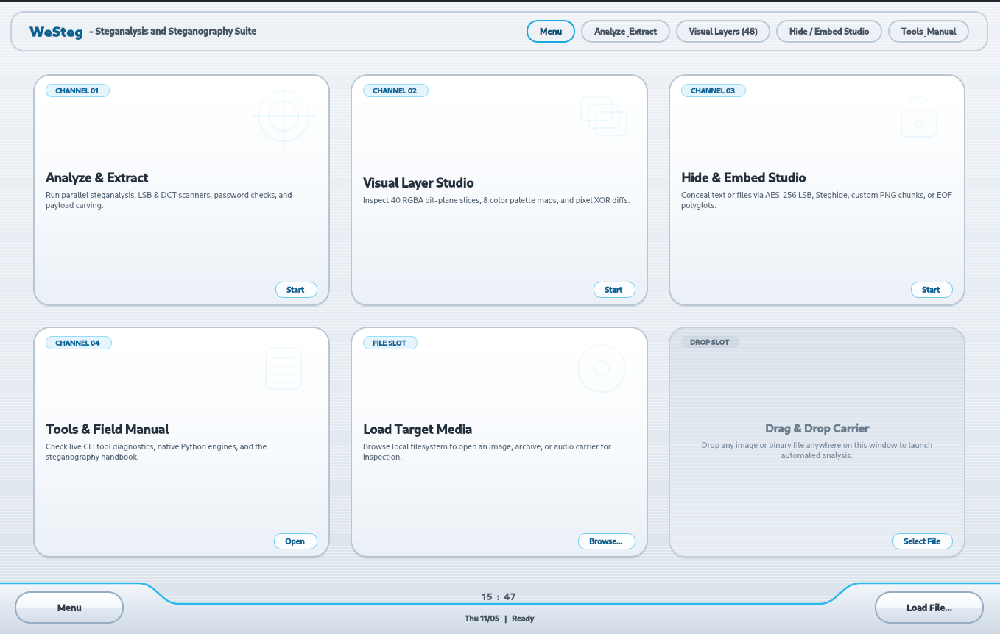
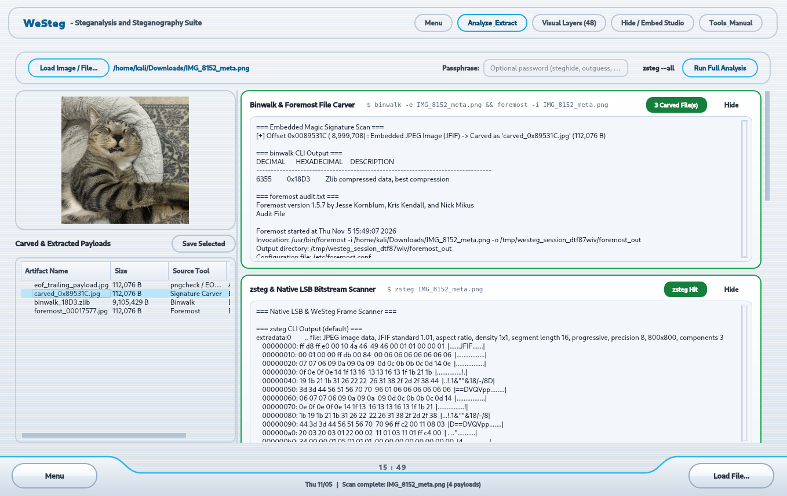
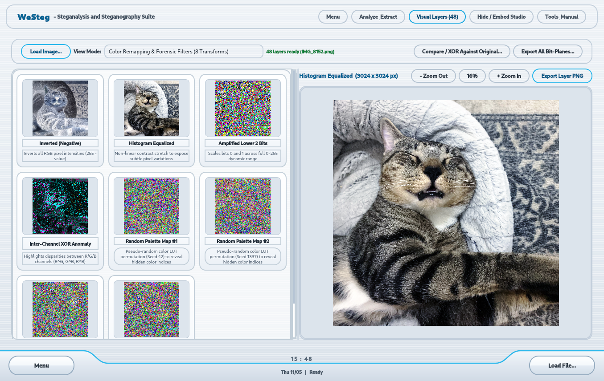
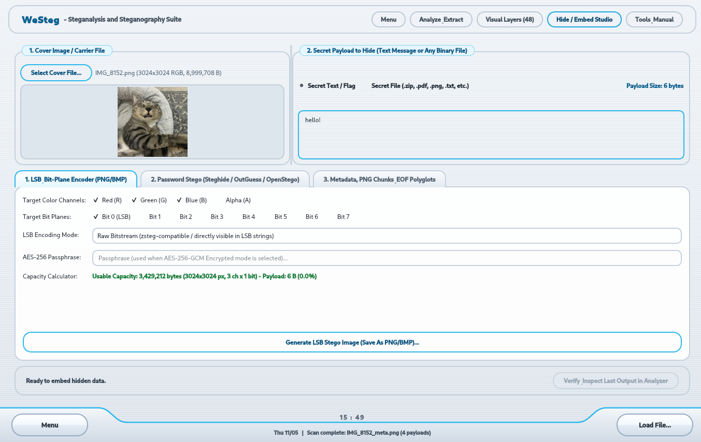

# WeSteg - Steganalysis and Steganography Suite

A cross-platform **PyQt6 Desktop GUI** application for **Windows and Linux** that combines:
1. **Aperi'Solve-style Automated Steganalysis & Forensics** (concurrent execution of pure-Python native engines for LSB, PNG chunks, EXIF, EOF polyglots, strings, and signature-validated file carving, plus automatic integration with `zsteg`, `steghide`, `stegseek`, `binwalk`, `foremost`, `exiftool`, `pngcheck`, and `outguess` when installed on `PATH`).
2. **48-Layer Visual Bit-Plane & Color Remapping Inspector** (all 8 bit planes across `Red`, `Green`, `Blue`, `Alpha`, and `RGB Combined`, plus 8 forensic palette/contrast filters and an image-to-image **XOR Pixel Comparator**).
3. **Steganography Creation Studio ("Hide / Embed Studio")** for hiding your own text messages, flags, or binary files inside images and media.

<p align="center">
  
</p>

---

## Installation & Setup (Windows & Linux)

All core steganography and steganalysis features (48-layer visual bit-plane inspector, LSB raw/framed/AES-256-GCM encoder and decoder, EXIF reader/writer, PNG chunk injector/verifier, EOF polyglot builder/detector, ASCII/UTF-16LE strings extractor, and signature-validated file carver) run **natively in Python** on both Windows and Linux.

### Windows Setup (PowerShell)

1. Open **PowerShell** in the project folder:
   ```powershell
   python -m venv .venv
   .\.venv\Scripts\Activate.ps1
   pip install --upgrade pip
   pip install -r requirements.txt
   ```
   *(Note: If PowerShell blocks script execution, run `Set-ExecutionPolicy -Scope Process -ExecutionPolicy Bypass` first.)*

2. Launch **WeSteg**:
   ```powershell
   python main.py
   ```

3. **Optional External CLI Tools on Windows:**
   If you want to enable optional third-party CLI tools (`exiftool`, `steghide`, `binwalk`) alongside the native Python engines, install them and ensure they are on your Windows `PATH` (for example, `winget install OliverBetz.ExifTool`).

---

### Linux Setup (Ubuntu / Debian / Kali / Fedora / Arch)

#### Option A: Automated Setup Script (Debian / Ubuntu / Kali)
Installs optional CLI packages via `apt`, `zsteg`, and sets up the `.venv` Python virtual environment automatically:
```bash
chmod +x setup_kali.sh
./setup_kali.sh
source .venv/bin/activate
python3 main.py
```

#### Option B: Manual Setup (Any Linux Distribution)
1. Create a virtual environment and install the Python dependencies:
   ```bash
   python3 -m venv .venv
   source .venv/bin/activate
   pip install --upgrade pip
   pip install -r requirements.txt
   ```
2. *(Optional)* Install external CLI tools via your distribution's package manager:
   - **Debian / Ubuntu / Kali:**
     ```bash
     sudo apt update && sudo apt install -y libimage-exiftool-perl pngcheck steghide foremost binwalk file ruby-full
     sudo gem install zsteg
     ```
   - **Fedora:**
     ```bash
     sudo dnf install -y perl-Image-ExifTool pngcheck steghide foremost binwalk file ruby
     gem install zsteg
     ```
   - **Arch Linux:**
     ```bash
     sudo pacman -S perl-image-exiftool pngcheck steghide foremost binwalk file ruby
     gem install zsteg
     ```
3. Launch **WeSteg**:
   ```bash
   source .venv/bin/activate
   python3 main.py
   ```

#### Option C: Build a Standalone Linux .AppImage
To build a portable, single-file `WeSteg-x86_64.AppImage` locally on Linux:
```bash
chmod +x build_appimage.sh
./build_appimage.sh
./WeSteg-x86_64.AppImage
```

---

### Command-Line Options & Self-Test

Open a file directly on startup:
```bash
python main.py suspicious_image.png
```

Run the headless verification self-test (Windows or Linux):
```bash
python main.py --self-test
```

---

## Feature Overview

### 1. Analyze & Extract (Aperi'Solve Engine)
- **Drag & Drop** any image or file (`PNG`, `JPG`, `BMP`, `GIF`, `WebP`, `WAV`, `AU`) onto the window.
- **Passphrase Bar:** Supply an optional candidate password that is passed simultaneously to `steghide`, `outguess`, and the `AES-256-GCM LSB` decryptor.
- **`zsteg --all` Toggle:** Switch between standard LSB scanning and exhaustive bit/channel permutation scanning.
- **Carved & Extracted Payloads Tree:** Any embedded files, archives, trailing EOF data, or LSB payloads extracted by native engines or CLI tools appear in the left-hand payload browser for one-click saving.

<p align="center">
  
</p>

### 2. Visual Bit-Planes & Forensic Filters (48 Layers)
- **40 Bit-Plane Layers:** View Bits `0` (LSB) through `7` (MSB) across `Red`, `Green`, `Blue`, `Alpha`, and `RGB Combined`.
- **8 Forensic & Palette Filters:** Inverted negative, Histogram Equalized, Amplified Lower 2 Bits, Inter-Channel XOR (`R^G`, `G^B`, `R^B`), and 4 deterministic pseudo-random Color LUT Remappings.
- **Zoomable Pixel Inspector:** Inspect any layer at up to `1200%` nearest-neighbor pixel zoom or export individual/all bit-plane PNGs.
- **Image XOR Comparator:** Compare a suspected stego image against an original carrier image to highlight modified pixels.

<p align="center">
  
</p>

### 3. Hide / Embed Studio (Create Steganography)
- **1. LSB & Bit-Plane Encoder (PNG/BMP):**
  - Choose target color channels (`R`, `G`, `B`, `A`) and bit planes (`0-7`) with a **Live Capacity Calculator**.
  - **Raw Bitstream (`zsteg`-compatible):** Directly readable by `zsteg` and `strings`.
  - **WeSteg Framed File:** Preserves exact filename and binary structure for any embedded file.
  - **AES-256-GCM Encrypted:** Encrypts your payload with PBKDF2-HMAC-SHA256 (100,000 iterations) before LSB embedding.
  - **Visual Bit-Plane Text Stamp:** Renders graphical text onto a single bit layer (e.g., Red Bit 0) so it is invisible to the naked eye but clearly readable in the Visual Bit-Plane Inspector.
- **2. Password-Protected CLI Wrappers:**
  - GUI frontends for **`steghide embed`** (`JPG`, `BMP`, `WAV`, `AU`), **`outguess`** (`JPG`), and **`openstego`** (`PNG`, `BMP`).
- **3. Metadata, PNG Chunks & EOF Polyglots:**
  - **EOF File Appender / Polyglot Builder:** Concatenate a `.zip` archive or secret file after `PNG IEND` or `JPEG EOI (0xFFD9)`.
  - **PNG Custom Chunk Injector:** Inject `tEXt`, zlib-compressed `zTXt`, or custom 4-char chunks (e.g., `sEcR`, `fLaG`) with valid CRC32 checksums before `IEND`.
  - **EXIF Metadata Injector:** Write custom payloads into `Artist`, `UserComment`, `Copyright`, and `ImageDescription`.
- **One-Click Roundtrip Verification:** Click **"Verify & Inspect Last Output in Analyzer"** to immediately test your newly created stego image in the Analyzer and Visual views.

<p align="center">
  
</p>

---

## Security & Architecture Notes

- **Safe Subprocess Execution:** All optional external CLI tools are invoked strictly as argument arrays (`shell=False`) with `stdin=subprocess.DEVNULL`, explicit `--` option terminators, and bounded execution timeouts.
- **Decompression Bomb & Memory Guards:** Built-in limits protect against oversized pixel buffers (`MAX_IMAGE_PIXELS`), truncated or maliciously large `zTXt`/`iTXt` zlib streams (`MAX_ZTXT_PREVIEW_DECOMPRESS`), and path-traversal filenames (`_sanitize_filename`) inside embedded payloads.
- **Ephemeral Session Cleanup:** Extracted artifacts are staged in isolated per-session temporary directories and automatically cleaned up on exit.

## License

Released under the [MIT License](LICENSE). Intended for educational use, CTF competitions, digital forensics, and authorized security research.

